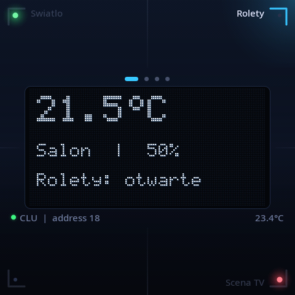
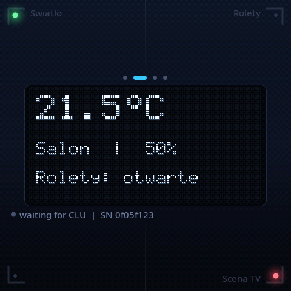

# opengr8on-smartpanel-rp2350 — emulator Grenton SMART_PANEL_FM_4

> **Uwaga / Note:** Dokumentacja, opisy protokołów i zachowanie firmware w tym repozytorium mogą
> zawierać błędy, nieścisłości lub domysły. Nie gwarantujemy ich dokładności ani kompletności.
> Oprogramowanie jest dostarczane bez żadnej gwarancji — zob. [Zastrzeżenie prawne](#zastrzeżenie-prawne).
>
> Documentation, protocol descriptions and firmware behaviour in this repository may contain errors,
> inaccuracies, or guesswork. No guarantee of accuracy or completeness is provided. The software
> comes with no warranty — see [Disclaimer](#disclaimer).

Firmware dla płytki **[Waveshare RP2350-Touch-LCD-4](https://www.waveshare.com/wiki/RP2350-Touch-LCD-4)** (dotykowy LCD 480×480, RS485), który na magistrali
TFBUS udaje moduł **Grenton SMART_PANEL_FM_4**. Współpracuje z prawdziwym CLU Grenton oraz z
[opengr8on-clu-esp32](https://github.com/psobiech/opengr8on-clu-esp32). Opis protokołu:
`docs/TFBUS.md` i `docs/TFBUS_SMART_PANEL_FM_4.md` w
[opengr8on-node](https://github.com/psobiech/opengr8on-node).

| Połączony z CLU (przycisk „Rolety” wciśnięty) | Czeka na CLU (bez adresu) |
|---|---|
|  |  |

Zrzuty pochodzą z renderera na hoście (`make -C test/host preview`), który używa tego samego kodu UI
(`src/ui.c`) co firmware.

## Projekt

Ekran odwzorowuje panel w nowoczesnej formie:

- **„OLED” 128×64** pośrodku, skalowany 3× z wyglądem matrycy punktowej. CLU rysuje na nim tekst i
  grafikę tak jak na prawdziwym panelu (`PrintText`, `Draw`), fontem bitmapowym 5×7.
- **Cztery ćwiartki dotykowe** (sloty 1–4) zajmują cały ekran, łącznie z obszarem OLED. Każda ma w
  rogu delikatny narożnik, etykietę przycisku (z CLU) i zieloną/czerwoną diodę. Wciśnięta ćwiartka
  podświetla narożnik i poświatę w rogu.
- **Strony**: przesunięcie palcem w lewo/prawo (> 80 px) przełącza stronę; 4 strony × 4 przyciski =
  `PANEL_BUTTON` 1–16. Wskaźnik strony jest nad OLED-em.
- **Pasek stanu** pod OLED-em: połączenie z CLU, adres RS485, temperatura; dopóki CLU nie nada
  adresu — numer seryjny.

Zdarzenia przycisków generuje panel, tak jak prawdziwy: naciśnięcie → `OnSwitchOn`, `OnChange`;
puszczenie → `OnSwitchOff`, `OnChange`, potem `OnClick` (< 0,5 s) / `OnShortPress` (< 2 s) /
`OnLongPress`; `OnHold` po `HoldDelay` (1000 ms) i co `HoldInterval` (100 ms). Palec, który
przesuwa stronę, anuluje swoje naciśnięcie (`OnSwitchOff` + `OnChange`, bez `OnClick`).

Struktura:

| Katalog | Zawartość |
|---|---|
| `core/` | logika panelu i protokół TFBUS (`panel_core.c`), czyste C bez zależności od sprzętu |
| `src/` | firmware: RS485, dotyk, buzzer, temperatura (`main.c`), UI (`ui.c`), fonty |
| `board/` | definicja płytki i sterowniki LCD/dotyku/IMU skopiowane z demo Waveshare (`board/README.md`) |
| `test/host/` | testy i podgląd UI na PC |
| `tools/` | generator fontów (`gen_font.py`) |
| `external/clu-esp32` | submoduł; testy używają z niego parsera ramek CLU |

## Kompletność

Działa:

| CLU → panel | Odpowiedź panelu |
|---|---|
| RESET (rozgłoszenie) | porzuca swój adres |
| SEEK | ACK, jeśli bez adresu |
| DISCOVER `0x08` (rozgłoszenie) | jeśli bez adresu: `AA 00 08 SN(LE) 03 03 04 XOR` |
| ADDR_ASSIGN(własny SN, a) | przyjmuje adres a, ACK |
| STATUS_POLL | `01 06 01 01 00` (+ `02 02 10 temp` co 1,25 s, + `08 02 10 VAL 00` — jedno zdarzenie przycisku na zapytanie, VAL = przycisk×7 + zdarzenie) |
| VERSION_QUERY | brak odpowiedzi (jak prawdziwy panel) |
| LED_CMD `0x18 mask_lo mask_hi cmd` | zielona / czerwona / wył., ShowOK / ShowError migają 2 s |
| TFBUS_CMD `0x31`: `0x0a` PRINT_TEXT, `0x19` DRAW, `0x0f` BEEP | rysowanie do bufora OLED i wyświetlanie, buzzer |
| każda inna ramka unicast | ACK |

Brakuje / nie zostało rozpoznane:

- **Wgrywanie konfiguracji stron i przycisków** (podkomendy `0x30` DISPLAY_BLOCK, `0x31 0x12`,
  `0x31 0x1a`, `0x17`). Strony mają domyślny układ (strona p, slot s → przycisk 4(p−1)+s).
  Założenie: podkomenda `0x0a` w `0x30` to etykieta przycisku, `0x00` to IconA (pokazywana jako
  tekst — brak ikon BMP).
- **Polecenia rysowania** ClearScreen, DrawLine, DrawPoint, DrawIcon, PrintFloat, ShowButtons —
  format ramek nieznany.
- **Gesty, zbliżenie i czujnik światła** — panel nie wysyła tych zdarzeń do CLU. Płytka nie ma
  czujnika zbliżeniowego ani światła, więc `ProximityTimeout` jest przyjmowany, ale ignorowany
  (ekran nie gaśnie).
- **Mapowanie ustawień TFBUS_CMD** (`0x02` ProximityTimeout, `0x0c` BuzzerValue, `0x14`
  ButtonsLEDMode, `0x15` PageControlMode) wywnioskowane z kolejności wartości w zrzucie magistrali,
  niepotwierdzone.
- **Kolizje DISCOVER**: dwa panele bez adresu odpowiadają jednocześnie, CLU widzi zniekształconą
  odpowiedź i rezygnuje po 3 próbach. Nie wiadomo, jak unikają tego prawdziwe moduły.
- **Polskie znaki**: fonty mają tylko ASCII i `°`; tekst UTF-8 z CLU jest transliterowany
  („Światło” → „Swiatlo”).
- **Prawdziwe CLU Grenton**: nie sprawdzono, czy wysyła DISCOVER we właściwym momencie.

## Co ma ponad oryginał

- Etykiety przycisków i stan diod widoczne na ekranie przy każdym przycisku.
- Multi-touch: każda ćwiartka to osobny przycisk, do 5 palców jednocześnie (śledzone po track id
  GT911; palec zostaje przy ćwiartce, w której zaczął).
- Pasek stanu z połączeniem z CLU, adresem RS485 i temperaturą.
- Numer seryjny i gotowa linia do OM.LUA na ekranie i na USB przy starcie.
- Diagnostyka na USB: co 5 s statystyki RS485 (`[rs485] rx … errors, frames ok/bad, tx, addr,
  last rx`), co 30 s surowy odczyt temperatury.
- Podgląd UI i testy bez sprzętu, w tym odtwarzanie prawdziwego zrzutu magistrali.

## Sprzęt

- **[Waveshare RP2350-Touch-LCD-4](https://www.waveshare.com/wiki/RP2350-Touch-LCD-4)** — RP2350, LCD 480×480 (ST7701), dotyk GT911, IMU QMI8658
  (temperatura), RS485, buzzer.
- **Magistrala TFBUS** z CLU: prawdziwe CLU Grenton albo
  [ESP32 CLU](https://github.com/psobiech/opengr8on-clu-esp32) (np. na płytce
  [Waveshare ESP32-S3-RS485-CAN](https://www.waveshare.com/wiki/ESP32-S3-RS485-CAN)).
- Przewód do RS485: **A/B płytki → A/B TFBUS, wspólna masa**. Transceiver na płytce sam przełącza
  kierunek (brak pinu DE).
- Zasilanie płytki zgodnie z [dokumentacją Waveshare](https://www.waveshare.com/wiki/RP2350-Touch-LCD-4) (np. USB-C).
- Kabel USB do wgrania firmware i podglądu logów.

## Budowanie

Wymagania:

- `arm-none-eabi-gcc` + `arm-none-eabi-newlib`
- CMake ≥ 3.13, `make` lub `ninja`, Python 3 (wymaga go Pico SDK), git
- [Pico SDK](https://github.com/raspberrypi/pico-sdk) ≥ 2.1 (sprawdzone na 2.2.0) z submodułem `tinyusb`

```bash
git clone --recurse-submodules https://github.com/psobiech/opengr8on-smartpanel-rp2350.git
cd opengr8on-smartpanel-rp2350   # w istniejącym klonie: git submodule update --init

git clone --depth 1 -b 2.2.0 https://github.com/raspberrypi/pico-sdk ~/pico-sdk
(cd ~/pico-sdk && git submodule update --init --depth 1 lib/tinyusb)

cmake -B build -DPICO_SDK_PATH=~/pico-sdk
cmake --build build -j
```

Wynik: `build/smartpanel.uf2`. Wgrywanie: przytrzymaj **BOOT**, podłącz USB, skopiuj
`build/smartpanel.uf2` na dysk RP2350, który się pojawi.

Fonty (`src/font_aa.h`, Noto Sans, SIL Open Font License 1.1) są w repo. Do ich ponownego
wygenerowania potrzeba Pillow i Noto Sans: `python3 tools/gen_font.py > src/font_aa.h`.

## Konfiguracja

### Opcje budowania

| Opcja | Domyślnie | Jak ustawić |
|---|---|---|
| Numer seryjny | `0x0f05fxxx` z unikalnego ID pamięci flash | `cmake -B build -DPANEL_SN=0x0f05xxxx` |
| Korekta temperatury | `-13` °C | `cmake -B build -DCMAKE_C_FLAGS="-DPANEL_TEMP_OFFSET=-8.0f"` |

Wyliczane numery seryjne leżą w zakresie `0x0f05f000..0x0f05ffff`, z dala od zakresu, w którym
widziano prawdziwe panele (`0x0f057bxx`).

**Temperatura** pochodzi z czujnika w IMU QMI8658 (zapasowo: wewnętrzny czujnik RP2350), odczyt raz
na sekundę. Odrzucane są nieudane transfery I2C i wartości spoza -30..85 °C; CLU dostaje medianę z
5 ostatnich poprawnych próbek, obciętą do 0 °C. Układ leży obok RP2350 i podświetlenia LCD, więc
pokazuje więcej niż temperatura pokoju. Kalibracja: korekta = temperatura pokoju − wartość
`[temp] raw` wypisywana na USB co 30 s.

### Magistrala

115200 8N1. Odpowiedź wychodzi 800 µs po zapytaniu — szybsza kolidowała z ESP32 CLU, które jeszcze
trzymało DE, i pierwsze bajty ginęły.

### Dodanie panelu do CLU

Panel przedstawia się jako hwType `0x03`, fwType `3`, fwApiVer `4`. Numer seryjny i linia do OM.LUA
są wypisywane przy starcie na USB i na ekranie.

- **Ręcznie (ESP32 CLU)** — dopisz moduł i obiekty do OM.LUA, np.:
  ```lua
  mm_252047651 = OBJECT:new(2, 0x0f05f123, 0x03, "0f05f123") -- 252047651 03 04
  PAN0001 = OBJECT:new(29, mm_252047651, 0, "PAN0001")
  PBU0001 = OBJECT:new(30, mm_252047651, 0, "PBU0001")   -- przycisk 1 (kanał 0)
  ```
- **Wykrywanie** — panel bez adresu odpowiada na rozgłoszenie DISCOVER (`0x08`) swoim SN i typem.
  ESP32 CLU dopisuje go do `a:\config.txt` (`0f05xxxx:03:03:04`, lista czytana przez OM) i
  `a:\CONFIG.JSON`, więc wykrywanie CLU w OM / „Clear CLU” pokazuje go jako nowy SMART_PANEL_FM_4 i
  zapisuje do OM.LUA.

## Testy

Wymagania: `gcc` lub `clang` z AddressSanitizer/UBSan, `make`; do podglądu dodatkowo Python 3 z
Pillow. Submoduł `external/clu-esp32` musi być pobrany.

```bash
make -C test/host test                     # testy rdzenia
make -C test/host test CAPTURE="/ścieżka/tfbus_capture_20261014_171505.log"  # + odtworzenie zrzutu magistrali
make -C test/host preview                  # podgląd UI -> test/host/preview_*.png
```

Test sprawdza na hoście:

- wykrywanie i bajty statusu względem odpowiedzi prawdziwego panelu,
- ACK na sekwencję inicjalizacji panelu z prawdziwego CLU,
- dotyk → zdarzenia przycisków, diody, PrintText / Draw / Beep,
- że każda wysłana ramka przechodzi przez parser ramek ESP32 CLU.

Odtworzenie zrzutu podaje ~44 tys. prawdziwych ramek z magistrali (wszystkie moduły) i sprawdza, że
panel odpowiada dokładnie na ramki adresowane do niego.

## Licencje

Kod źródłowy projektu jest objęty licencją [AGPLv3](LICENSE.txt), z wyjątkiem komponentów
zewnętrznych wymienionych niżej.

- `board/` — definicja płytki i sterowniki skopiowane z pakietu demo Waveshare; obowiązują ich
  licencje (szczegóły w [board/README.md](board/README.md)).
- `src/font_aa.h` — font Noto Sans, [SIL Open Font License 1.1](https://openfontlicense.org).

Opisy protokołów, na których opiera się firmware, pochodzą z
[opengr8on-node](https://github.com/psobiech/opengr8on-node) (dokumentacja: CC BY-SA 4.0).

## Zastrzeżenie prawne

Projekt nie jest popierany przez, bezpośrednio powiązany z, utrzymywany, autoryzowany ani
sponsorowany przez Grenton Sp. z o.o. ani Waveshare.

Użycie jakichkolwiek nazw handlowych lub znaków towarowych służy wyłącznie celom identyfikacyjnym i
referencyjnym i nie implikuje żadnego związku z właścicielem znaku towarowego ani jego marką
produktową.

Wszelkie nazwy produktów, logotypy, marki i inne znaki towarowe lub obrazy wymienione na tej stronie
stanowią własność ich odpowiednich właścicieli.

Korzystanie z tego oprogramowania — w tym podłączanie urządzenia z tym firmware do magistrali
TF-Bus i CLU Grenton — może naruszać warunki gwarancji urządzeń Grenton. Użytkownik ponosi
wyłączną odpowiedzialność za ocenę zgodności z warunkami gwarancji producenta przed użyciem tego
oprogramowania z urządzeniami objętymi gwarancją.

Zdarzenia przycisków z panelu mogą w CLU sterować fizycznymi urządzeniami (przekaźniki, rolety,
oświetlenie). Błędy w oprogramowaniu, sprzęcie lub konfiguracji mogą spowodować nieoczekiwane
zdarzenia i załączenie lub wyłączenie obwodów. Nie używaj go do sterowania obwodami, od których
zależy bezpieczeństwo ludzi lub mienia. Instalację elektryczną powinna wykonywać osoba z
odpowiednimi uprawnieniami.

Oprogramowanie jest dostarczane w stanie „takim, jaki jest” (as-is), bez jakichkolwiek gwarancji,
wyraźnych ani dorozumianych, w tym między innymi bez gwarancji przydatności handlowej, przydatności
do określonego celu ani nienaruszania praw osób trzecich. O ile wyraźnie nie zaznaczono inaczej,
osoba która powiązała utwór z niniejszą adnotacją nie udziela żadnych gwarancji dotyczących tego
utworu i zrzeka się odpowiedzialności za wszelkie sposoby jego użycia, w najszerszym zakresie
dopuszczalnym przez obowiązujące prawo.

---

### Licenses

Project source code is licensed under [AGPLv3](LICENSE.txt), except for the third-party components
listed below.

- `board/` — board definition and drivers copied from the Waveshare demo package; their own licences
  apply (see [board/README.md](board/README.md)).
- `src/font_aa.h` — Noto Sans font, [SIL Open Font License 1.1](https://openfontlicense.org).

Protocol descriptions the firmware is based on come from
[opengr8on-node](https://github.com/psobiech/opengr8on-node) (documentation: CC BY-SA 4.0).

### Disclaimer

This project is not endorsed by, directly affiliated with, maintained, authorized, or sponsored by
Grenton Sp. z o.o. or Waveshare.

The use of any trade name or trademark is for identification and reference purposes only and does
not imply any association with the trademark holder of their product brand.

Any product names, logos, brands, and other trademarks or images featured or referred to within this
page are the property of their respective trademark holders.

Use of this software — including connecting a device running this firmware to the TF-Bus and to a
Grenton CLU — may void the warranty of your Grenton devices. It is solely your responsibility to
evaluate whether using this software with warranted hardware complies with the manufacturer's
warranty terms.

Button events from this panel may control physical equipment through the CLU (relays, roller
shutters, lighting). Bugs in the software, hardware or configuration may cause unexpected events and
switch circuits on or off. Do not use it to control circuits on which the safety of people or
property depends. Electrical installation work should be done by a qualified person.

This software is provided "as-is", without warranty of any kind, express or implied, including but
not limited to the warranties of merchantability, fitness for a particular purpose, and
non-infringement. Unless expressly stated otherwise, the person who associated a work with this deed
makes no warranties about the work, and disclaims liability for all uses of the work, to the fullest
extent permitted by applicable law.
